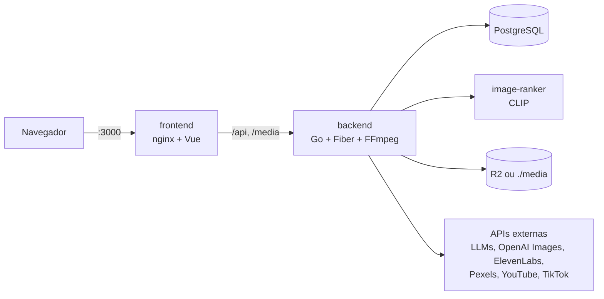
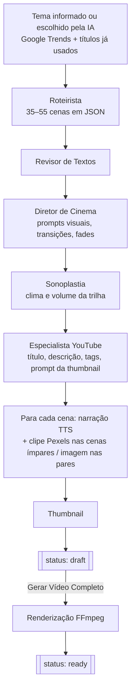
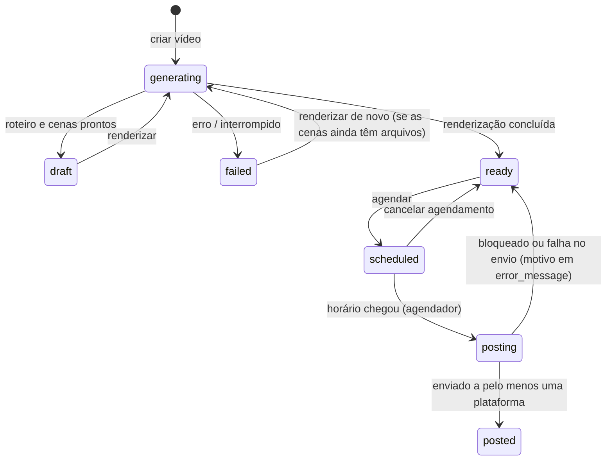

# Arquitetura e fluxos

## Visão geral

- O navegador fala **só com o nginx** (mesma origem). O nginx repassa `/api/*` e `/media/*` ao backend, então o app funciona atrás de qualquer domínio ou HTTPS sem configurar CORS.
- Os arquivos gerados (imagens, áudios, vídeos) vão para o **Cloudflare R2** quando ele está configurado. Sem R2, ficam no volume `backend_media` e são servidos em `/media`.
- Todo o processamento pesado (LLM, TTS, FFmpeg, uploads) roda em **goroutines do backend**. Não há fila externa: se o processo reinicia, os trabalhos em andamento são recuperados como descrito em [Rotinas em segundo plano](#rotinas-em-segundo-plano).

## Modelo de dados (resumo)

| Tabela | Conteúdo |
|---|---|
| `users` | Contas (e-mail, hash bcrypt) |
| `channels` | Identidade do canal, logo e capa, abertura e encerramento (status e progresso), voz do narrador, tokens OAuth do YouTube/TikTok (nunca enviados ao frontend), flag do Piloto Automático |
| `auto_pilot_configs` | Por canal: vídeos por semana, hora preferida, falhas consecutivas e backoff, motivo da última pausa |
| `videos` | Metadados, roteiro, status, progresso, caminhos dos arquivos, agendamento, IDs no YouTube/TikTok, notas dos agentes |
| `scenes` | Cada cena: narração, imagem ou clipe, áudio, duração, se usou conteúdo de reserva |
| `api_usage_logs` | Cada chamada a API externa: provedor, operação, unidades exatas e custo estimado em US$ |
| `app_settings` | Chaves salvas pela tela de Configurações (sobrepõem o `.env`) |
| `analytics_data` | Métricas por vídeo (estrutura pronta; a coleta real ainda não está implementada) |

O schema é criado e atualizado automaticamente (GORM AutoMigrate) a cada start.

## Criação de canal

`POST /api/channels` com o nicho (e, opcionalmente, o nome):

1. **LLM:** gera nome, conceito, persona, tom de narração e ideias visuais para o logo e a capa.
2. **Imagens (em paralelo):** logo quadrado (PNG) e capa 3:2 (JPEG), a partir de prompts de direção de arte (`BuildLogoPrompt` / `BuildBannerPrompt`).
3. Cria o canal com o Piloto Automático **ligado** e uma configuração padrão de 7 vídeos por semana às 18h.
4. **Em segundo plano:** gera abertura e encerramento. O LLM escreve o texto, o revisor corrige, o TTS narra e o FFmpeg monta um clipe com a capa (ou o logo). Esses clipes entram no início e no fim de todo vídeo renderizado depois.

## Pipeline de um vídeo

Cada agente tem um **supervisor**, uma segunda chamada de LLM que avalia a saída e pede uma nova tentativa quando ela não está boa. Se um agente falhar, o pipeline segue com a versão anterior. Só a falha do Roteirista interrompe o vídeo.

### Renderização (`CompileVideo`)

1. Cada cena vira um segmento 1920×1080, 25 fps, com zoom lento (Ken Burns) e fades. O FFmpeg processa até 4 cenas em paralelo.
   - Cena sem imagem ou clipe recebe um clipe genérico de reserva; cena sem narração recebe silêncio. Essas cenas são marcadas como **degradadas**.
2. Concatena abertura, cenas e encerramento.
3. Gera as legendas `.srt` em blocos de 3 a 6 palavras, sincronizadas pela duração real de cada segmento.
4. Gera a versão final 16:9 com legenda queimada e uma trilha de ruído procedural (azul para suspense, rosa para negócios, marrom para o resto).
5. Gera o **Shorts 9:16**: recorte vertical das primeiras `SHORTS_MAX_SECONDS` (padrão 60 s), com legenda maior.
6. Envia os arquivos ao R2, se configurado, e **apaga os arquivos de origem das cenas** para economizar espaço. Por isso um vídeo `ready` não pode ser renderizado de novo.

### Status de um vídeo

| Status | Rótulo no painel | Observação |
|---|---|---|
| `generating` | Gerando | Roteiro ou renderização em andamento; o painel mostra o progresso |
| `draft` | Rascunho | Roteiro e cenas prontos, falta renderizar |
| `ready` | Pronto | Vídeo renderizado; pode ser agendado |
| `scheduled` | Agendado | Aguardando o horário |
| `posting` | Publicando | Download e upload em andamento |
| `posted` | Publicado | Os arquivos renderizados são apagados do armazenamento (`media_purged`) |
| `failed` | Falhou | O motivo aparece no painel |

### Publicação

A cada minuto, o agendador pega os vídeos `scheduled` cujo horário já passou e os muda **atomicamente** para `posting`, o que impede que o mesmo vídeo seja publicado duas vezes. Para cada um:

1. Exige ao menos uma conta conectada (YouTube ou TikTok).
2. Baixa o vídeo para um arquivo temporário local se ele estiver no R2.
3. **Trava de qualidade:** o vídeo precisa ter pelo menos 120 s e no máximo 30% de cenas degradadas.
4. Envia o 16:9 ao **YouTube** (upload resumable). Título, descrição e tags são ajustados aos limites da API.
5. Envia o 9:16 ao **TikTok** (Content Posting API, em blocos quando passa de 64 MB).
6. Se ao menos um envio der certo: `posted`, com `youtube_video_id` e/ou `tiktok_publish_id`. A falha da outra plataforma fica como aviso.
7. Se nenhum der certo: volta para `ready`, sem agendamento e com o motivo visível. O vídeo não fica tentando de novo a cada minuto.

## Piloto Automático

Roda a cada **10 minutos** para cada canal com o Piloto ligado. Cada canal tem uma trava própria, então dois ciclos nunca rodam ao mesmo tempo no mesmo canal. Antes de gerar qualquer coisa, o ciclo checa, nesta ordem:

| Checagem | Se não passar |
|---|---|
| Backoff após falhas: espera de 10 min, dobrando a cada falha consecutiva, até 6 h | Aguarda |
| Pelo menos uma conta de postagem conectada | Pausa e mostra "Nenhuma conta conectada" (sem gastar créditos) |
| Menos de 2 vídeos na fila (`generating`, `scheduled` ou `posting`) | Pausa até a fila andar |
| Menos de `videos_per_week` vídeos criados nos últimos 7 dias | Pausa até a janela liberar |

Se tudo passar, o ciclo escolhe um tema inédito (tendências do Google Trends BR/US e os títulos que o canal já usou), gera e renderiza o vídeo e o **agenda no próximo horário livre**:

- Até 7 vídeos por semana: no máximo 1 por dia, sempre na hora preferida, a cada `ceil(7/n)` dias.
- Mais de 7 por semana: espaçados igualmente em horas.

Se a Shotstack estiver configurada, a renderização roda na nuvem dela; senão, localmente com FFmpeg.

O motivo da última pausa ou falha aparece na página do canal (`GET /api/channels/:id/autopilot-status`).

## Provedores e ordem de uso

| Função | Ordem |
|---|---|
| Texto (roteiros, agentes, identidade) | Groq `llama-3.3-70b-versatile` → Gemini `gemini-flash-latest` → Claude `claude-sonnet-5-5` → OpenAI `gpt-4o-mini` |
| Logo, capa e thumbnail | OpenAI `gpt-image-1.5` → Gemini `gemini-3.1-flash-lite-image`. O Pollinations só entra se nenhum dos dois estiver configurado |
| Imagem de cena | Foto do Pexels (a melhor de 5, escolhida pelo CLIP) → Pollinations (gratuito) → Gemini |
| Clipe de cena (cenas ímpares) | Vídeo do Pexels sem marca d'água (o melhor de 5, pelo CLIP) |
| Narração | ElevenLabs `eleven_multilingual_v2` (voz escolhida por canal; padrão "Adam") → OpenAI `tts-1` (voz onyx) → Google Tradutor (gratuito, corta em 200 caracteres) |
| Renderização | FFmpeg local; a Shotstack só é usada pelo Piloto Automático, quando configurada |

Quando todos os provedores de uma função falham, a mensagem de erro traz o motivo de **cada um** (chave inválida, cota, timeout…).

### Custos

Toda chamada externa é registrada em `api_usage_logs`. As unidades (tokens, caracteres, imagens) vêm exatas da resposta de cada API; o valor em US$ é uma **estimativa** pela tabela em `backend/internal/services/costs.go`. O painel de cada canal mostra o total por API e operação, por vídeo e por dia, além do uso da cota gratuita diária do Gemini (somando todos os canais).

## Rotinas em segundo plano

| Rotina | Frequência | O que faz |
|---|---|---|
| Agendador | 1 min | Publica os vídeos agendados que já venceram |
| Watchdog | 5 min | `generating` parado há mais de 20 min vira `failed`; `posting` parado há mais de 2 h volta para `ready`; abertura ou encerramento em geração há mais de 10 min vira falha |
| Recuperação no boot | a cada start | Tudo que estava em andamento é recuperado na hora, porque nenhum processo continua esses trabalhos depois de um restart |
| Piloto Automático | 10 min | Ver acima |

## Segurança

- **Autenticação:** JWT HS256 com validade de 7 dias, assinado com `JWT_SECRET`. O algoritmo é fixo na validação.
- **Cadastro:** fechado por padrão (`ALLOW_REGISTRATION=false`), porque toda conta usa as chaves pagas do operador.
- **Isolamento:** cada usuário só vê os próprios canais e vídeos. Recursos de outro usuário respondem 404.
- **OAuth:**
  - A URL de consentimento sai de um endpoint autenticado, com um `state` assinado (HMAC) que liga usuário, canal e provedor e expira em 15 min.
  - O callback rejeita qualquer `state` que o próprio servidor não tenha emitido.
  - O PKCE do TikTok usa um verificador diferente por fluxo.
- **Segredos:** os tokens OAuth e as chaves nunca voltam para o frontend; `/api/settings` informa apenas se cada um está configurado.
- **Rede:** no `docker compose`, o Postgres e o backend só aceitam conexões de `127.0.0.1`. O único ponto público é o frontend.
